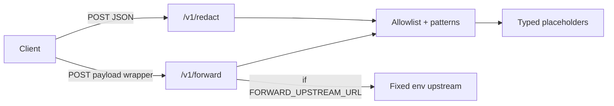

# pii-redaction-proxy

Lean **local HTTP service** (FastAPI) that redacts a **fixed, documented JSON field-path allowlist** using conservative string patterns. This is **not** anonymization and **not** detect-all PII scanning.

Portfolio demo targeting privacy, security, and backend interviews. **Synthetic fixtures only** — no real cards or credentials.

## Quickstart

```bash
python -m venv .venv
source .venv/bin/activate
pip install -r requirements-dev.txt
uvicorn app.main:app --reload --port 8080
```

### Redact locally

```bash
curl -sS -X POST http://127.0.0.1:8080/v1/redact \
  -H 'Content-Type: application/json' \
  -d '{
    "customer": {
      "email": "synthetic.user+demo@example.test",
      "phone": "+15551234567"
    },
    "metadata": {
      "secretEmail": "note-this-stays-visible@example.test"
    }
  }' | jq
```

Expected: `customer/email` and `customer/phone` become typed placeholders; `metadata/secretEmail` is **unchanged** (false negative by design).

### Allowlist reference

```bash
curl -sS http://127.0.0.1:8080/v1/allowlist | jq
```

### Optional forward demo (fixed upstream only)

Set **`FORWARD_UPSTREAM_URL`** in the environment to a single trusted base URL. The client **cannot** override upstream via body, query, or headers.

```bash
export FORWARD_UPSTREAM_URL=http://127.0.0.1:9000/v1/echo
curl -sS -X POST http://127.0.0.1:8080/v1/forward \
  -H 'Content-Type: application/json' \
  -d '{"payload": {"customer": {"email": "synthetic.user+demo@example.test"}}}'
```

Without `FORWARD_UPSTREAM_URL`, `/v1/forward` returns **503** with redacted preview only.

## Architecture



1. **Bounded read** — request bodies streamed with a **1 MiB** cap (`MAX_REQUEST_BYTES`); oversize → **413** (not Content-Length alone).
2. **Parse** — JSON object root required.
3. **Walk** — depth bounded (`MAX_JSON_DEPTH`); exceed → **422**.
4. **Redact** — only documented paths; pattern match → placeholder; else leave value as-is.

## Design decisions

| Choice | Rationale |
|--------|-----------|
| Explicit path allowlist | Deterministic, auditable behavior for interviews and tests |
| Typed placeholders | Shows *what* was redacted without claiming anonymization |
| Luhn only on allowlisted PAN paths | Reduces false positives on arbitrary digit strings |
| E.164-only phones | Conservative; US formatting false negatives documented |
| No open proxy | Upstream solely from env; redirect following disabled |
| Safe logging | Counts/flags only — no raw bodies |

## Limitations (intentional)

- **False negatives**: PII in non-allowlisted fields (e.g. `metadata/secretEmail`) is not scanned.
- **False negatives**: Phone numbers not in E.164 (e.g. `(555) 123-4567`) on allowlisted paths stay visible.
- **Not anonymization**: Placeholders are reversible in spirit (same input → same placeholder type).
- **No ML / NER**, no recursive secret discovery.
- Forwarding is a **demo**; production would add mTLS, allowlist egress, and policy-as-code.

## Development & CI

```bash
ruff check app tests
mypy app
pytest -q
docker build -t pii-redaction-proxy:local .
```

GitHub Actions runs pytest, ruff, mypy, and Docker build on PRs.

## AI assistance disclosure

This repository was **built with AI coding assistance** as a portfolio demonstration. It is **not** a claim that Habib Noor personally authored or exhaustively hardening-tested every line. **No employer affiliation or hiring guarantee** is implied.

## License

MIT — see [LICENSE](LICENSE).
